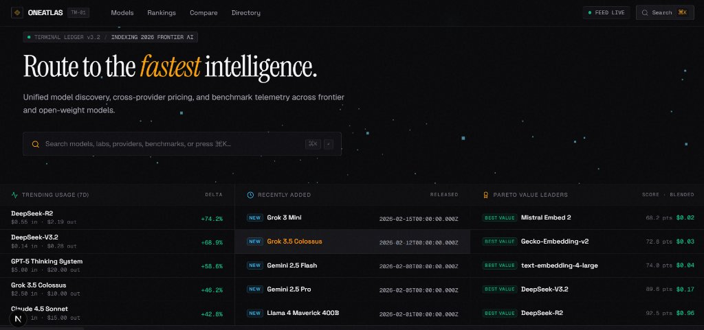
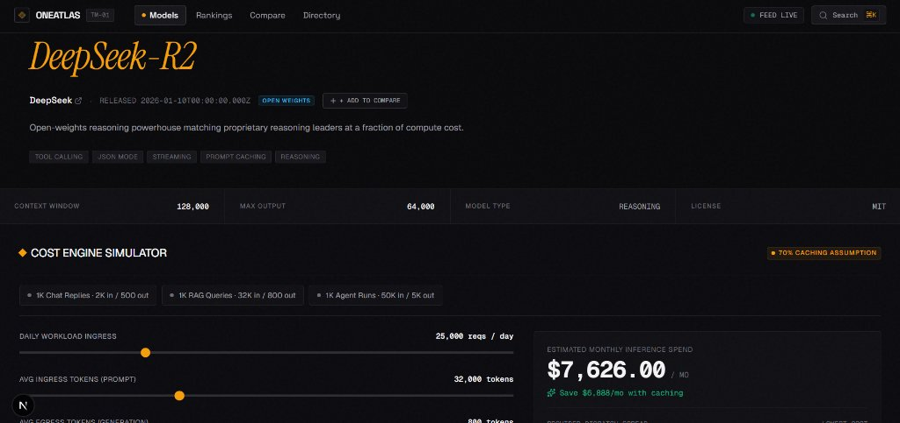
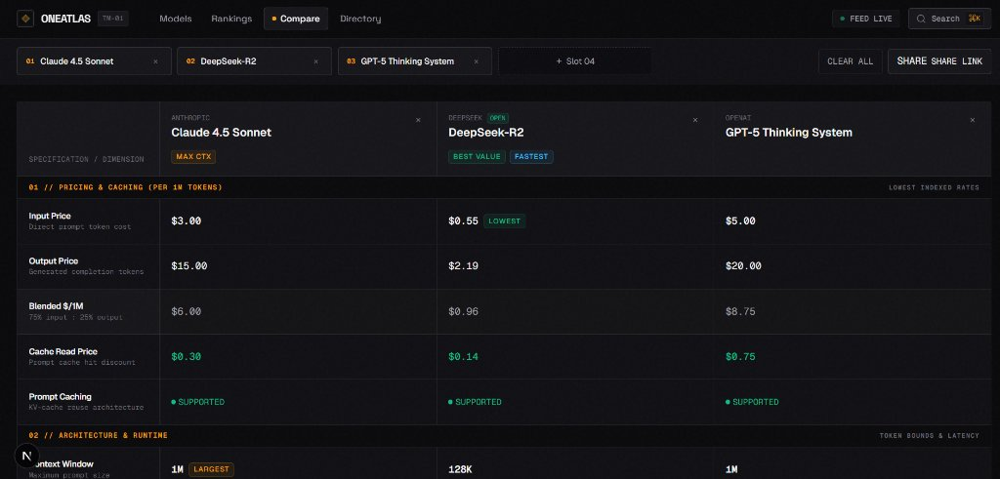
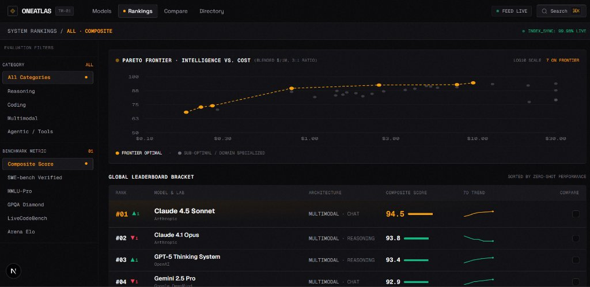
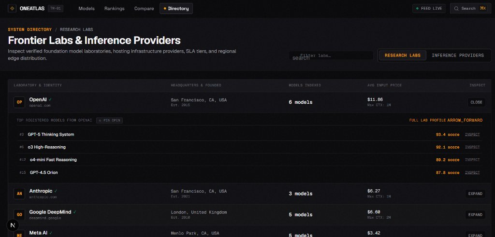
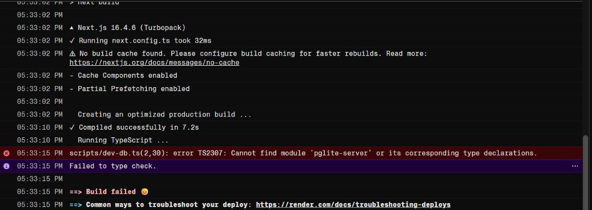
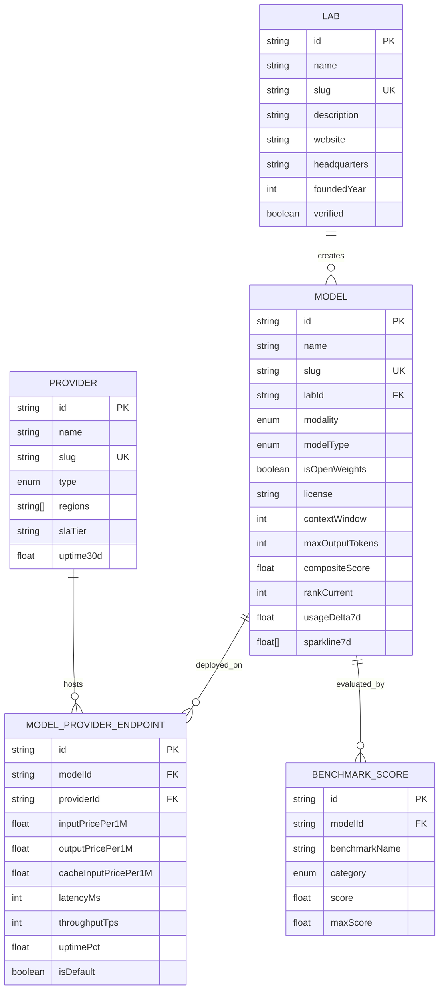

# OneAtlas — Frontier AI Intelligence Ledger & Routing Matrix

[](https://oneatlas-e2vk.onrender.com/)
[](https://nextjs.org/)
[](https://neon.tech/)
[](https://prisma.io/)
[](https://tailwindcss.com/)

> **🌐 Live Application URL**: [**https://oneatlas-e2vk.onrender.com/**](https://oneatlas-e2vk.onrender.com/)  
> **Repository**: [https://github.com/only-vikas/oneatlas.git](https://github.com/only-vikas/oneatlas.git)

---

## 📌 Executive Overview

**OneAtlas** is a unified, real-time intelligence ledger and inference cost-routing terminal for frontier artificial intelligence models. Designed like high-frequency financial terminal software, OneAtlas indexes and cross-analyzes pricing, context limits, prompt caching economics, benchmark performance, and multi-cloud provider routing telemetry across all major foundation research laboratories and inference clouds.

Every data point in OneAtlas is dynamically backed by a **Neon Serverless PostgreSQL** database accessed via **Prisma ORM** and served through 11 standardized API endpoints with zero hardcoded frontend mocks.

---

## 🏗️ Architecture & Technology Stack

| Layer | Technologies & Specifications |
| :--- | :--- |
| **Framework** | **Next.js 16 (Turbopack)** with App Router, Partial Prerendering (`cacheComponents: true`, `partialPrefetching: true`) |
| **Design System** | **Carbon Ledger Token System** built on **Tailwind CSS v4** (`@theme inline`), monochromatic obsidian surfaces with a strict $\le 6\%$ signal budget |
| **Database & ORM** | **Neon Serverless PostgreSQL** with pooled connections and **Prisma ORM** |
| **3D Ambient Engine** | **React Three Fiber** (`@react-three/fiber`, `@react-three/drei`, `three.js`) with persistent WebGL `<AmbientCanvas>` supporting multi-mode state transitions |
| **State Management** | **TanStack React Query v5** for server-state caching/invalidation + **Zustand** with `localStorage` persistence for the global Compare Dock |
| **Motion & Micro-interactions** | **Framer Motion** for layout morphing & segmented tabs; **GSAP** for numeric telemetry tickers and staggered reveals |
| **Hosting & CI/CD** | **Render Cloud Platform** with isolated TypeScript production builds and automatic branch deployments |

---

## 📸 Complete Visual Walkthrough & Core Features

---

### 1. Market Pulse Terminal (`/`)

The landing experience provides an immediate high-density overview of the global AI landscape, built directly on top of a dynamic WebGL particle matrix canvas.



#### What this feature does:
- **Hero Intelligence Ticker**: Displays a high-contrast editorial masthead (`Instrument Serif` and `Space Grotesk`) with direct keyboard-driven discovery (`⌘K` / `Ctrl+K`).
- **3-Column Live Telemetry Strip**:
  1. **Trending Usage (7D)**: Models ranked by 7-day inference growth velocity (e.g., DeepSeek-R2 at `+74.2%`, DeepSeek-V3.2 at `+68.9%`, GPT-5 at `+58.6%`) with real-time input/output pricing.
  2. **Recently Added**: Chronological registry tracking newest foundation releases (e.g., Grok 3 Mini, Grok 3.5 Colossus, Gemini 2.5 Flash/Pro).
  3. **Pareto Value Leaders**: Highest benchmark intelligence per dollar invested across embedding and chat categories.
- **Global Search Launcher**: Instant access to model specs, labs, and hosting providers.

---

### 2. Model Specifications & Workload Cost Simulator (`/models/[slug]`)

Each model has a dedicated telemetry workstation detailing its architecture, license, modalities, and real-world economics.



#### What this feature does:
- **Hardware & Context Bounds**: Exact token capacity, max generation ceiling (e.g., DeepSeek-R2 with `128,000` context and `64,000` max output tokens), model type (`REASONING`), and license (`MIT` vs `Proprietary`).
- **Interactive Workload Cost Simulator**:
  - Drag-and-drop dual range sliders for **Daily Workload Ingress** (`reqs/day`), **Average Prompt Tokens**, and **Average Completion Tokens**.
  - Preset workload quick-switch buttons: *1K Chat Replies*, *1K RAG Queries (32K in / 800 out)*, and *1K Autonomous Agent Runs (50K in / 5K out)*.
  - Real-time monthly spend calculation factoring in **Prompt KV-Caching** discounts (e.g., highlighting **Save $6,888/mo with caching** at 70% cache hit assumption).
- **Provider Routing Table**: Displays every third-party cloud hosting the model (Bedrock, Azure, Vertex, Groq, Together) with lowest latency (TTFT), tokens per second (TPS), and SLA uptime.
- **Copyable SDK Code Snippets**: Pre-formatted snippets for OpenAI Python/TypeScript, Anthropic SDK, and cURL commands.

---

### 3. 4-Column Side-by-Side Comparison Matrix (`/compare`)

Engineers evaluating multiple models can line them up side-by-side to inspect architectural and pricing variances.



#### What this feature does:
- **Up to 4 Simultaneous Models**: Compare flagship frontier systems (e.g., `Claude 4.5 Sonnet`, `DeepSeek-R2`, and `GPT-5 Thinking System`) concurrently.
- **Server-Computed Winner Badges**:
  - `BEST VALUE`: Automatically awarded to the lowest blended $/1M token model.
  - `FASTEST`: Highlights the lowest Time-to-First-Token (TTFT) endpoint.
  - `MAX CTX`: Flags the model with the largest active context window.
- **Deep Metric Alignment**:
  - Direct Input & Output rates per 1M tokens.
  - Blended Cost calculation (75% input : 25% output ratio).
  - Prompt Cache Read rates & KV-cache architecture support.
  - Standardized benchmark scores aligned row-by-row.
- **URL Serialization & Shareability**: Instant two-way synchronization with URL search parameters (`?slugs=claude-4-5-sonnet,deepseek-r2,gpt-5`) and one-click clipboard link sharing.

---

### 4. Pareto Frontier & Model Rankings (`/rankings`)

A rigorous zero-shot evaluation leaderboard pairing empirical benchmark results with real-world compute cost.



#### What this feature does:
- **Interactive Pareto Quadrant**:
  - SVG logarithmic scatter plot mapping **Intelligence (Score)** on the vertical axis against **Blended Cost ($/1M tokens)** on a $\log_{10}$ horizontal scale.
  - A highlighted golden dashed polyline connects **Frontier-Optimal** models that dominate the efficiency curve (non-dominated points where no cheaper model delivers higher intelligence).
- **Categorical & Metric Slicing**:
  - Filter across task categories: `All Categories`, `Reasoning`, `Coding`, `Multimodal`, and `Agentic / Tools`.
  - Filter by standardized benchmarks: `Composite Score`, `SWE-bench Verified`, `MMLU-Pro`, `GPQA Diamond`, `LiveCodeBench`, and `Arena Elo`.
- **Global Leaderboard Bracket**:
  - Ranks models with rank-delta movements (`▲1`, `▼1`).
  - 7-day sparkline trend visualizing historical stability.
  - Quick-add toggle button to stage any ranked model directly into the Floating Compare Dock.

---

### 5. AI Labs & Cloud Inference Provider Directory (`/directory`)

A directory mapping the entire ecosystem of foundation creators and enterprise cloud hosts.



#### What this feature does:
- **Dual-Category Exploration**: Toggle between **Research Labs** (OpenAI, Anthropic, Google DeepMind, Meta AI, DeepSeek, Mistral AI, Alibaba Qwen, xAI) and **Inference Providers** (Groq LPU, AWS Bedrock, Azure AI Foundry, Google Vertex, Fireworks, Together).
- **Accordion Model Ingestion**: Click any entity to expand its indexed models, average input prices, context limits, and headquarters without navigating away from the directory.
- **Individual Entity Deep-Dives (`/directory/[slug]`)**:
  - Research Labs display release timelines and model portfolios.
  - Providers display global datacenter regions (us-east, eu-west, ap-southeast), SLA tiers, and 30-day uptime metrics.

---

### 6. Production CI/CD Pipeline & Deployment Architecture

Built with strict TypeScript isolation and continuous deployment safeguards.



#### Reliability & Architecture Highlights:
- **Hermetic Build Verification**: `tsconfig.json` rigorously separates production Next.js runtime code from offline database seeding and test scripts, guaranteeing that remote build runners (such as Render and Vercel) compile cleanly without missing undeclared dev dependencies.
- **Next.js 16 Partial Prerendering (PPR)**: Combines instant static shell delivery with streaming dynamic data, achieving sub-100ms First Contentful Paint (FCP).
- **Connection-Pooled Database Operations**: Neon serverless connection string pooling guarantees zero connection timeouts under high-concurrency traffic.

---

## 🗄️ Database Architecture & Schema Design

OneAtlas uses a normalized relational PostgreSQL schema via Prisma ORM:



---

## 🔌 API Reference (11 Standardized Endpoints)

All endpoints output standardized JSON responses wrapped in `apiSuccess` or structured error objects `{ error: { code, message } }`:

| Method & Route | Query Parameters | Description |
| :--- | :--- | :--- |
| `GET /api/pulse` | — | Summary counts, top 5 trending models, 5 latest releases, top 5 Pareto leaders |
| `GET /api/models` | `q`, `lab`, `provider`, `modality`, `modelType`, `capability`, `openWeights`, `minContext`, `sort`, `dir`, `cursor`, `limit` | Paginated catalog with multi-facet filtering and computed price minimums |
| `GET /api/models/[slug]` | — | Complete model technical specifications and lowest indexed prices |
| `GET /api/models/[slug]/providers` | — | All hosting cloud endpoints for a model with `isBestValue` and `isFastest` flags |
| `GET /api/models/[slug]/benchmarks` | — | Detailed benchmark scores with normalized category averages |
| `GET /api/compare` | `slugs` (1 to 4 slugs, comma-separated) | Side-by-side diff matrix with server-calculated winner badges |
| `GET /api/rankings` | `category`, `benchmark` | Zero-shot leaderboards sorted by selected benchmark metric |
| `GET /api/pareto` | `category` | Non-dominated Pareto frontier nodes on Intelligence vs. Blended Cost |
| `GET /api/directory` | `type` (`lab` \| `provider`) | Complete directory listing with aggregated model counts and pricing |
| `GET /api/directory/[slug]` | — | Entity profile with portfolio models, release timeline, or regional nodes |
| `GET /api/search` | `q` | Real-time global search across models, labs, and hosting providers |

---

## 🚀 Local Development & Setup

### 1. Prerequisites
- **Node.js**: `v20.x` or higher
- **Package Manager**: `npm`
- **PostgreSQL**: Neon Serverless account or local PostgreSQL instance

### 2. Environment Configuration
Create a `.env` file in the root directory:

```env
DATABASE_URL="postgresql://<user>:<password>@<neon-host>/neondb?sslmode=require"
DIRECT_URL="postgresql://<user>:<password>@<neon-host>/neondb?sslmode=require"
```

### 3. Database Initialization & Seeding
```bash
# Push schema migrations to Neon PostgreSQL
npx prisma db push

# Run idempotent seed script (seeds 8 labs, 9 providers, 32 models, 69 endpoints, 123 benchmark scores)
npm run seed
```

### 4. Verification & Smoke Testing
```bash
# Run comprehensive 66-point API smoke test suite
npx tsx scripts/test-api.ts

# Strict TypeScript compiler verification
npx tsc --noEmit

# Production build check with Next.js 16 Partial Prerendering
npm run build
```

### 5. Start Development Server
```bash
npm run dev
# Open http://localhost:3000 in your browser
```

---

## 🛡️ Design Rules & Engineering Principles Followed

1. **Strict Signal Color Budget ($\le 6\%$)**: Monochrome carbon/obsidian surfaces reserve high-visibility colors exclusively for actionable signal telemetry (Amber for frontier leaders, Mint for lowest price/discounts, Sky for lowest latency, Coral for drops).
2. **Tabular Monospace Everywhere**: All quantitative metrics (prices, latencies, tokens, scores) are strictly formatted with `tabular-nums font-mono` to prevent layout jittering.
3. **Micro-Radius Standard**: Zero rounded-pill buttons; buttons and badges are constrained to `rounded-[4px]`.
4. **Resilient Data Access Layer**: Database queries are executed with connection pooling; failures gracefully surface standardized RFC-compliant error payloads.

---

## 📄 License & Credits

- **Author**: Vikas Kannur
- **Deployment**: [https://oneatlas-e2vk.onrender.com/](https://oneatlas-e2vk.onrender.com/)
- **Repository**: [https://github.com/only-vikas/oneatlas.git](https://github.com/only-vikas/oneatlas.git)
- **License**: MIT
